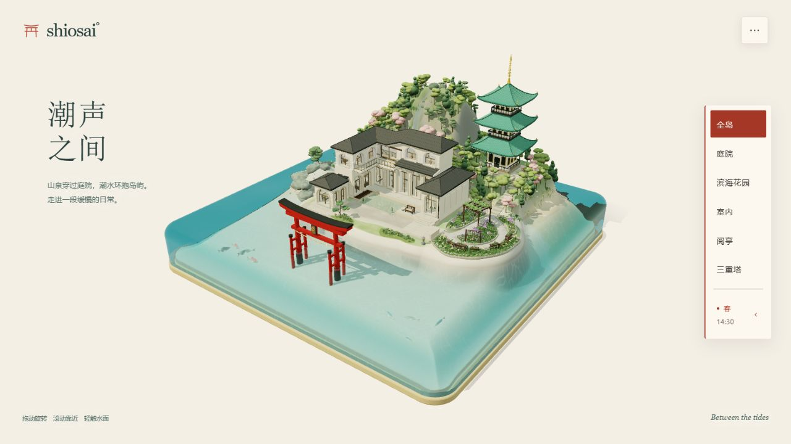

# shiosai° · 潮声之间

一座受日本海岸景观启发的想象岛屿。山泉穿过庭院，潮水环抱住宅，滨海花园随四季更替，三重塔在林木之间静立。



## 体验

- 六处精选风景：全岛、庭院、滨海花园、室内、阅亭、三重塔。
- 鸟居启动标识与实际场景构建进度，加载完成后进入岛屿。
- 朱印与暖纸色的界面，右侧垂直导航，季节和时间分行呈现；适配手机与较矮屏幕。
- 切换春、夏、秋、冬，调整白天至夜晚的光线、潮位、水面起伏与飘落粒子。
- 拖动旋转、滚轮缩放、轻触水面；右上角更多菜单提供恢复视角、专注观看、全屏和作品介绍。

## 本地运行

需要 Node.js 18 或更高版本，以及支持 WebGL 2、ES Modules 和 Import Maps 的现代浏览器。建议启用浏览器硬件加速。

```sh
git clone https://github.com/Lake-Evendim/shiosai.git
cd shiosai
npm start
```

打开 <http://127.0.0.1:8192/>，点击「走进这座岛」。首次构建三维场景需要一些时间，启动页会显示实际进度。

Three.js 已随项目保存，无需安装依赖或执行构建。请通过 HTTP 访问，直接双击 HTML 文件无法正常加载模块。

若默认端口被占用，可在 PowerShell 中指定其他端口：

```powershell
$env:PORT = '8193'
npm start
```

## 文件

| 文件 | 内容 |
| --- | --- |
| `index.html` | 启动页、场景导航与设置面板 |
| `site.css` / `site.js` | 页面样式、启动进度和场景进入流程 |
| `controls.css` / `controls.js` | 朱印风格交互与响应式适配 |
| `scene-engine.js` | 程序生成几何、材质、光照、水面与场景相机 |
| `vendor/` | Three.js r160 与所需附加模块 |
| `scripts/serve.cjs` | 本地静态服务器 |

当前版本包含季节过渡、水面夜间亮度、室内照明，以及阅亭壁画与家具位置的修复。

## 第三方依赖

Three.js r160 使用 MIT 许可证，完整许可文本见 [`vendor/LICENSE.three`](vendor/LICENSE.three)。依赖来源和文件清单见 [`THIRD_PARTY_NOTICES.md`](THIRD_PARTY_NOTICES.md)。
